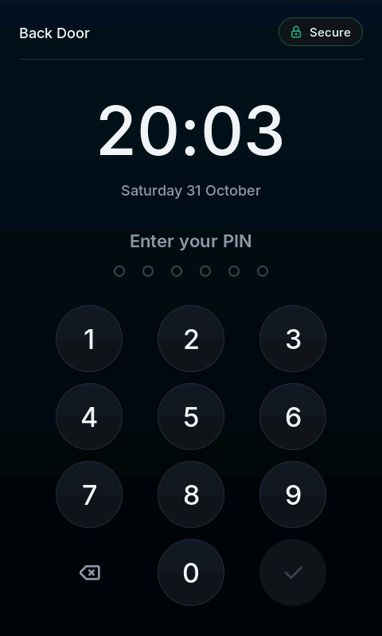
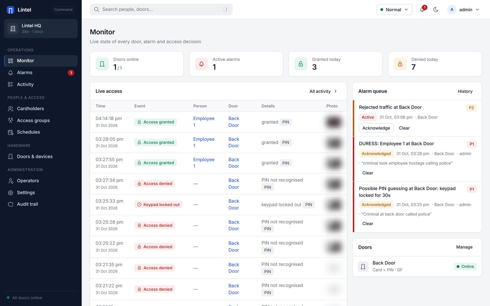
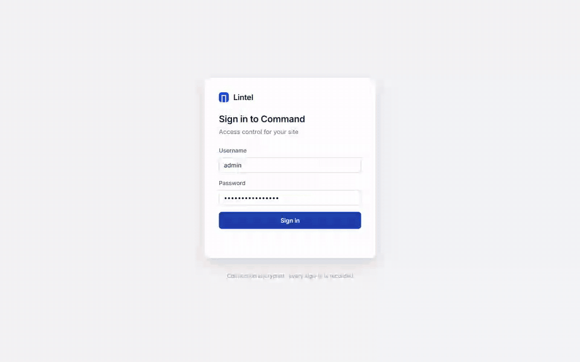
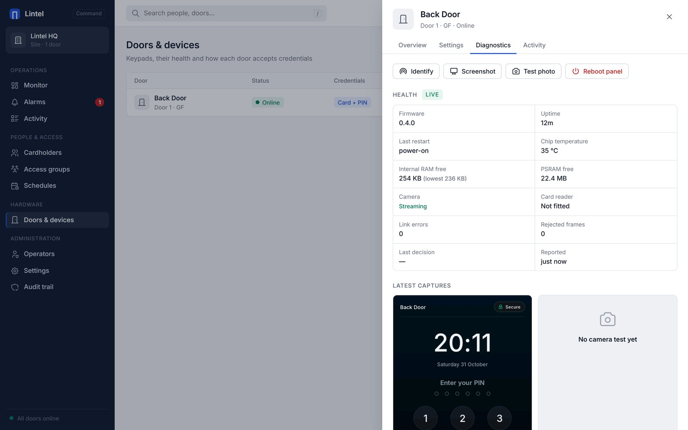
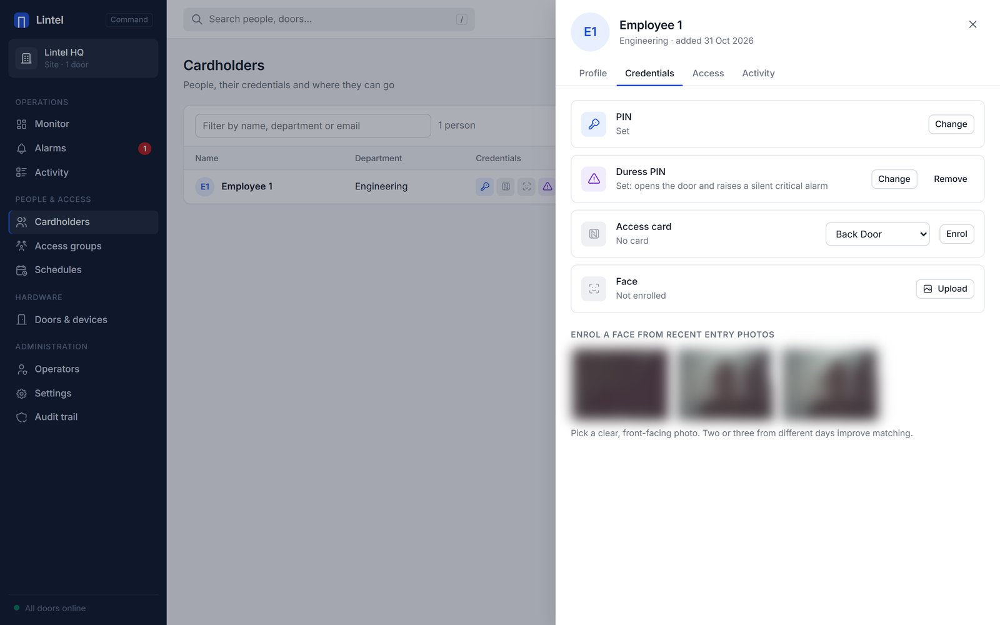
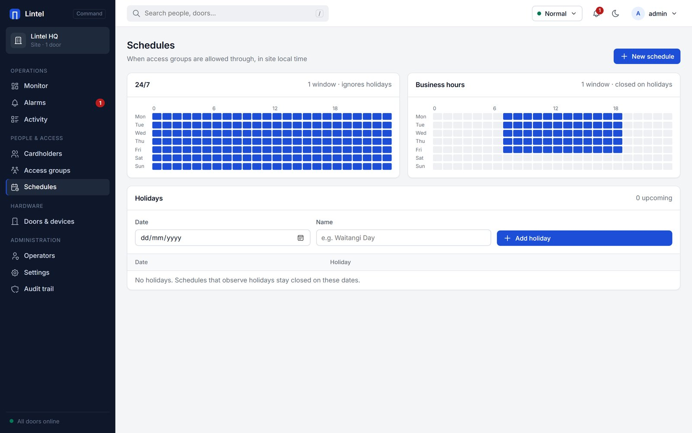
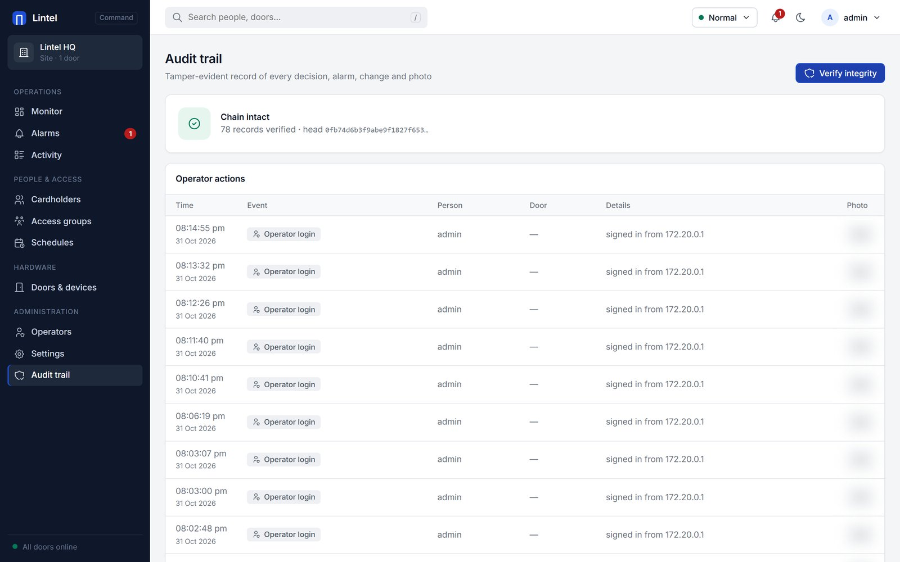

<p align="center">
  
</p>

<h1 align="center">Lintel</h1>

<p align="center">
  <b>Access control from the keypad to the console.</b><br>
  A touchscreen door keypad on an ESP32-P4, a keyless door controller, and an
  operator server with a web console. Designed the way commercial systems are,
  with every security decision written down and tested.
</p>

<p align="center">
  <a href="https://github.com/xDarkzx/Lintel/actions/workflows/ci.yml"></a>
  <a href="LICENSE"></a>
  
  
</p>

<p align="center">
  <a href="BUILDING.md">Building</a> ·
  <a href="docs/SECURITY.md">Threat model</a> ·
  <a href="docs/hardware.md">Hardware</a> ·
  <a href="docs/BUILT-WITH-AI.md">How it was built</a> ·
  <a href="CONTRIBUTING.md">Contributing</a>
</p>

```
 Keypad (ESP32-P4, 4.3" touch, camera)          Door controller (Pi Zero class)            Server (Docker)
 ┌───────────────────────────────┐   USB    ┌──────────────────────────────┐  UDP + HTTPS  ┌────────────────────────────┐
 │ PIN pad · lockout · photos     │◄────────►│ keyless relay                │◄─────────────►│ decisions · cardholders     │
 │ X25519 identity · AES-CCM      │  CDC-ACM │ pinned TLS · controller token│               │ alarms · audit chain        │
 │ fail-secure lock output        │          │ photo / screenshot uplink    │               │ web console · face matching │
 └───────────────────────────────┘          └──────────────────────────────┘               └────────────────────────────┘
```

<p align="center">
  
  &nbsp;
  
</p>
<p align="center"><sub>Left: the keypad's own screen, captured remotely from the console. Right: the operations console (entry photos blurred).</sub></p>

The keypad has no network of its own and holds no PINs. Every message between
keypad and server is sealed with that door's AES-128 key, so the controller in
the middle, or anyone who takes it over, can relay traffic but cannot read it
or forge a grant.

## What it does

**At the door**
- PIN entry on a standard keypad; the server decides, the panel never stores PINs
- Three wrong PINs lock the keypad (30 s, doubling to 15 min), raise a critical
  alarm and photograph the person; every attempt is photographed
- Duress PIN: opens normally, silently raises a critical alarm
- Tailgating detection with no extra camera: after a grant the keypad records
  the open doorway, and the server counts the people who go through against
  the credentials used. Counting only, no face processing of bystanders;
  frames are deleted unless they are evidence for the alarm
- Face + PIN doors decide on both together; on PIN doors, a clear face that
  is plainly not the PIN's owner raises a "PIN used by someone else" alarm
- Screen follows the door's mode (PIN, card, card + PIN, face, face + PIN),
  name and site lockdown, all delivered from the server
- Fail-secure lock relay output; remote unlock from the console with a reason

**Commissioning**
- New keypads announce themselves and appear in the console as unassigned,
  with serial and MAC address
- Adoption needs the 6-digit pairing code shown on the keypad's screen; the
  door key is then sealed to the keypad's own X25519 key, so it never crosses
  the network in the clear and never has to be typed
- Key rotation and unassignment are delivered the same way

**Operations console**
- Live monitor, alarm queue with acknowledgement notes, searchable activity
  with CSV export, cardholders, access groups, schedules with holidays,
  doors and devices, operators, settings, audit trail
- Diagnostics per keypad: uptime, last reset reason, memory, chip
  temperature, camera, link errors, rejected frames, decision latency,
  remote screenshot, test photo, identify, reboot
- Guided face enrolment with liveness checks (random head-turn steps and
  anti-spoofing on every frame, judged on the server); card enrolment by
  tapping at a door
- Encrypted backup; alarm webhook to Teams, Slack or a pager

## Screens



<sub>Recorded against the running system: the keypad screenshot in the door's diagnostics is requested from the real panel mid-recording (its clock moves from 20:11 to 20:15). Cardholder names are replaced and entry photos blurred.</sub>

| | |
|---|---|
|  |  |
| Door diagnostics: health, remote commands, live screen capture | Cardholder credentials: PIN, duress PIN, card and face enrolment |
|  |  |
| Schedules as week grids, with holidays | Audit trail verified end to end |

## How it was built

Almost all of the code was written by an AI coding agent under my direction,
with every security claim backed by a test and checked on the hardware.
[docs/BUILT-WITH-AI.md](docs/BUILT-WITH-AI.md) covers where the agent was
wrong and what caught it.

## Security model

The full threat model is in [docs/SECURITY.md](docs/SECURITY.md). In short:

| Layer | Mechanism |
|---|---|
| Keypad ↔ server | AES-128-CCM per door, 64-frame replay window, reboot-safe counters, every reply bound to the request it answers |
| Commissioning | X25519 + HMAC-derived key, pairing code checked by a person, monotonic sequence against rollback |
| Credentials | PINs and card UIDs stored only as keyed HMACs; the key lives outside the database |
| Audit | HMAC-SHA256 hash chain over every decision, alarm, operator action and photo hash |
| Console | HTTPS only, TOTP two-factor, sign-in throttling with alarm, `__Host-` cookies, CSP, Origin checks, roles |
| Controller | Pins the server certificate, presents a site token, holds no door keys |
| Deployment | Read-only container, all capabilities dropped, non-root, dependencies audited with pip-audit |

## Repository

| Path | What |
|---|---|
| `components/lintel_core` | Portable C++ protocol core: frames, counters, adoption, messages, policy, audit chain |
| `firmware/panel` | ESP32-P4 keypad firmware (ESP-IDF 5.4, LVGL 8) |
| `server/lintel_server` | FastAPI server, door controller relay, web console |
| `test/host` | GoogleTest suite for the core, run in Docker |
| `server/tests` | pytest suite for the server and controller |
| `firmware/door` | Earlier LoRa door node (Heltec ESP32-S3), kept for reference |

Shared golden vectors make the C++ firmware and the Python server prove they
produce byte-identical frames and adoption messages.

## Running it

Full instructions, including first sign-in and adopting a keypad, are in
[BUILDING.md](BUILDING.md).

```sh
# Server (generates admin credentials, TLS certificate and controller.env in server/data)
cd server && docker compose up -d --build        # https://localhost:8443

# Door controller, on the machine the keypad is plugged into
python -m lintel_server.door_controller --server <server-ip> --env server/data/controller.env

# Tests
scripts/host_test.sh                              # C++ core, also --asan
cd server && python -m pytest -q tests            # server

# Keypad firmware
.\scripts\idf.ps1 panel build
.\scripts\idf.ps1 panel '-p' COM4 flash
```

Hardware: Guition JC4880P443C (ESP32-P4 + ESP32-C6, 480×800 touch, OV02C10
camera). The keypad's high-speed USB socket is the controller link; the other
socket is for flashing and logs.

## Status

Verified on hardware: keypad UI and PIN decisions end to end through the
controller, entry and lockout photos, adoption with pairing codes, remote
diagnostics and screenshots, server-side face detection and matching on real
entry photos.

Next: RC522 card reader driver (wiring on JP1 is documented in
[docs/hardware.md](docs/hardware.md)), the keypad's face-scan flow, and
production firmware protection ([docs/production-hardening.md](docs/production-hardening.md)).

## Licence

Lintel is licensed under the [Functional Source License, Version 1.1, ALv2
Future License](LICENSE) (FSL-1.1-ALv2). You may use, modify and redistribute
it for any purpose except offering a competing commercial product or service.
Each release becomes available under the Apache License 2.0 two years after it
is published.

For commercial licensing, partnerships or pilot installations, contact
[@xDarkzx](https://github.com/xDarkzx). Bundled third-party components keep
their own licences; see [THIRD_PARTY_NOTICES.md](THIRD_PARTY_NOTICES.md).
